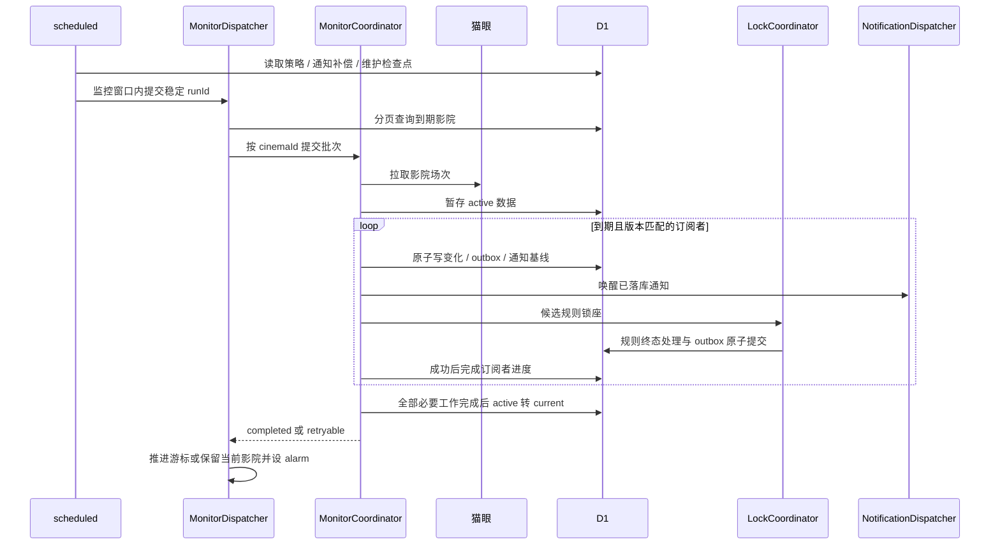
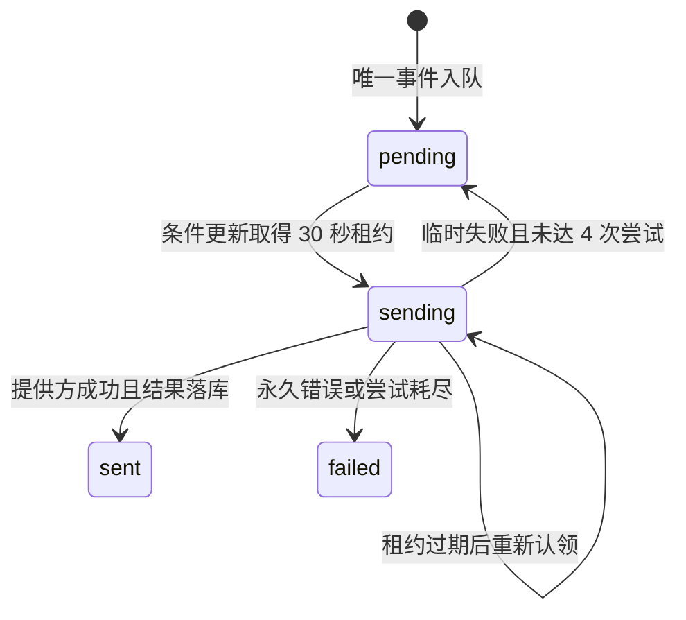

# Movie 监控、数据与通知

入口为 [index.js 的 scheduled](../worker/src/index.js)，
[wrangler.toml](../worker/wrangler.toml) 当前每 3 分钟触发。
监控和账号维护使用 D1 业务策略的北京时间窗口，不以旧文档中的用户上限、
有效天数或页面占位文案作为实际生产参数。

## 批次与影院协调

[MonitorDispatcher](../worker/src/maoyan/monitor-dispatcher.js) 使用全局 `main`
DO，通过 `currentBatch`、游标及最多一份较新的 `pendingBatch` 合并积压批次，
不是无限任务队列。每页查询 20 个到期影院；未完成、可重试或抛错时不跨过该影院，
alarm 继续推进。批次 ID 由计划触发时间和 Cron 步长计算，不是每次随机生成。

[MonitorCoordinator](../worker/src/maoyan/monitor-coordinator.js) 按影院 ID
分片并串行执行批次，同一影院订阅者共享场次数据。场次获取有超时；同一 `runId`
重试复用 D1 已暂存的 `active_data`。手动 `/api/check` 也经影院协调器做限流和
进行中请求合并，但不是完整的后台批次；`/api/shows` 仍直接获取场次。
缺少监控 DO 绑定时入口保留旧扫描回退，不应把回退描述为生产主链路。

## 状态提交与幂等

[monitor-store.js](../worker/src/maoyan/monitor-store.js) 将场次规范化、排序、去重
并计算哈希；`cinema_state` 每影院保存已提交 `current_*` 和处理中 `active_*`。
无场次变化时版本可不增长，但运行检查点、订阅进度和维护仍可能写入，不能称为
“零写入”。遗留快照辅助函数不代表当前主链路仍追加每批影院历史表。

`monitor_subscriptions` 保存用户配置版本、通知基线、下一次检查时间和已完成
`last_run_id`。第一次建立基线不推送已有场次；后续只对关注影片的新场次生成通知。
在 D1 batch 内用版本/基线 guard 同步写 `change_log`、唯一事件键 outbox 和新基线，
防止重试重复入队或陈旧配置推进进度。

通知基线与整批完成是不同状态。通知可能已经持久化并发送，但锁座准备失败仍让
影院批次保持可重试。只有必要的锁座工作和订阅者处理完成后，影院才把 `active_*`
提升为 `current_*`；重试不覆盖已完成用户的进度。取消、配置变更和账号撤销仍需
各自的版本/状态检查，不能只依赖单进程内串行化。

## 锁座协调与失败处理

[lock-api.js](../worker/src/maoyan/lock-api.js) 负责会话、模板/官方座位、规则和
取消入口；[lock-runner.js](../worker/src/maoyan/lock-runner.js) 的
`LockCoordinator` 按用户 ID 协调规则、会话操作及限流。
后台候选排序与有界并发由 [lock-lottery.js](../worker/src/maoyan/lock-lottery.js)
组织，默认并发是代码参数，不是容量承诺。

规则先匹配目标日期/时间/影厅，无法确定唯一场次则失败；尚未放映排期时继续等待。
读取会话和座位图后重新核对所选座位、布局、当前规则以及活跃账号，再提交原始
`seatNo` 创建未支付订单。已进入 `matching`、`unknown` 或终态的规则不会被后台
直接再下单。准备阶段失败是否继续等待取决于是否已进入 matching；下单异常走
终态并保存脱敏细节，不自动盲重试。用户应在猫眼确认订单实际结果。

规则终态处理与通知事件在 D1 batch 内一起提交：成功规则保存为 locked，失败或
过期规则从活动表删除，诊断与终态通知留在 outbox。通知发送失败不应重复创建订单。
新场次、锁座终态和反馈通知会分别唤醒通知通道；不必等待下一次 Cron 才尝试发送。

## 通知 outbox

[notification-outbox.js](../worker/src/maoyan/notification-outbox.js) 保存事件键、
用户、种类、消息、配置版本、状态与下一次尝试时间，不把推送密钥塞进消息负载。
投递前读取当前配置，校验账号、订阅版本/开启状态以及渠道验证；失效或已过时的
消息永久失败，不继续向旧配置发送。

临时失败按 30 秒、120 秒、600 秒退避；提供方要求更长等待时采用较长间隔。
租约过期允许恢复投递，DO alarm 和 Cron 的 `recoverPendingNotifications` 补偿
唤醒。紧急通道按“种类 + 用户”分片，到期提醒使用 routine 通道且仅在维护窗口
发送。唯一事件键和租约减少重复，但不能保证外部通知严格只发送一次：提供方
成功后进程若在写 `sent` 前中断，租约恢复仍可能再次发送。

## 维护与观察

[tokens.js](../worker/src/maoyan/tokens.js) 的 `runScheduledMaintenance` 管理
提醒、归档和撤销清理的分页检查点与异常审计。scheduled 先做通知恢复，再做维护，
然后才根据监控窗口决定是否发监控批次；非监控窗口仍可能查询、维护写入或发送
紧急通知。维护窗口关闭后的检查也会记录未完成情况。

结构化日志入口见 [log.js](../worker/src/maoyan/log.js)，生产查询权限及限制见
[Cloudflare 运维](cloudflare.md)。核验应同时检查 current/active 版本、批次游标、
订阅进度、outbox 状态及 DO alarm；不能用一次 HTTP 200 或“暂停”字段判断全部
任务完成。性能比较要固定负载，分别报告读、写及数据增长，不沿用历史估算。
