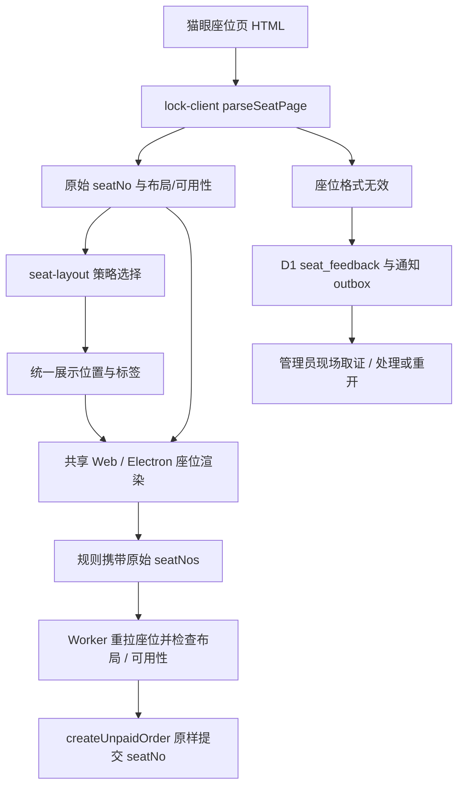

# Movie 座位解析、锁座标识与反馈

## 两种坐标不能混用

猫眼 `data-no` 是不透明下单主键，可能为分段字符串、纯数字或其他非空值。
`rowId`、`columnId`、派生的“几排几座”是展示与布局信息，不用于重新生成 `seatNo`。
Worker 与 Web/Electron 都必须保留原始主键。

## Worker 的解析与展示策略

[lock-client.js](../worker/src/maoyan/lock-client.js) 的 `parseSeatPage` 读取
`seats-block` 和座位 span，保留 `sectionId`、`sectionName`、`seqNo`、`cols` 与
每座的 `rowId`、`columnId`、`seatNo`、`type`、`orderIndex`、可用状态。
缺少关键块/元数据或没有有效座位时报格式错误，不把空页面当作正常可选座位图。

物理位置按每排 DOM 顺序计算，过道/空占位也计入 `orderIndex`，但不成为可选座位。
已售、不可用、未知与明确可选分别处理，未知不默认为可选。`cols` 提供物理总宽度，
前端缺失时才用最大位置兜底。展示座号和屏幕横向位置不一定相同，不能直接按
`seatNo` 字典序铺图。

[seat-layout.js](../worker/src/maoyan/seat-layout.js) 注册以下策略，结合整图字段
选择；不能仅凭某一个编号格式断言院线身份：

| 策略 | 解释与源码 |
| --- | --- |
| `wanda` | [分段格式的区-座-排](../worker/src/maoyan/seat-layout/strategies/wanda.js) |
| `huanying` | [分段格式的区-排-座](../worker/src/maoyan/seat-layout/strategies/huanying.js) |
| `numeric-id` | [纯数字主键，展示依赖布局字段](../worker/src/maoyan/seat-layout/strategies/numeric-id.js) |
| `alpha-row` | [字母等非数字排号](../worker/src/maoyan/seat-layout/strategies/alpha-row.js) |
| `default` | [缺省推导与字段兜底](../worker/src/maoyan/seat-layout/strategies/default.js) |

`resolveSeatPosition` / `seatDisplayLabel` 只派生位置和标签；无法推导时显示原始主键。
页面对应适配在 [Movie seat-layout.js](../modules/movie/pages/maoyan/seat-layout.js)，
锁座交互在 [lock.js](../modules/movie/pages/maoyan/lock.js)。两端实现不通过运行时
跨仓库 import 共享，调整编码规则时应同时核对 Worker 和页面测试。

## 模板与下单

[lock-rule.js](../worker/src/maoyan/lock-rule.js) 保留模板场次和选中座位的原始信息；
[lock-runner.js](../worker/src/maoyan/lock-runner.js) 对实际目标场次重拉座位图，
确认场次、所选座位和布局仍一致，防止将另一影厅或过期模板用于下单。
`createUnpaidOrder` 再检查非空、无重复且座位仍可用，将选中的原始 `seatNo`
与分区/场次信息一起提交，不从“几排几座”反推供应商参数。

官方图对比路径使用经提取/裁剪的座位 HTML，在页面沙箱中展示；原始网页脚本和
猫眼 Cookie 不应直接进入普通业务页面。正式下单域名和签名边界见[架构总览](movie.md)。

## 反馈与管理员闭环

[seat-feedback.js](../worker/src/maoyan/seat-feedback.js) 只保存时间、用户/影院/
影片/场次标识及来源，不保存原始 HTML、Cookie 或完整会话。主键为
`seatfb:{cinemaId}:{seqNo || "na"}`，同键覆盖而非无限堆积；自动反馈按中国日期
对同场次自动来源去重，手动反馈可更新。

`withSeatFeedback` 仅对“猫眼座位图格式无效”前缀的解析错误自动留档，并继续抛出
原错误；网络失败不会一概当作解析错误。反馈及管理员通知 outbox 原子落库，
通知唤醒失败由 Cron 补偿。留档失败静默返回，不改变锁座主流程的失败结果。

管理端可列出反馈、标记 `processed` / `unprocessed`、重新打开或删除记录。
处理者应按标识现场重拉座位页，核对策略、可用性和布局后加针对性测试，不能仅
凭反馈 ID 推断格式。测试入口包括 Worker 座位/规则测试和 Movie 页面座位测试，
命令见[知识库首页](README.md)；现场上游数据仍需单独核验。
