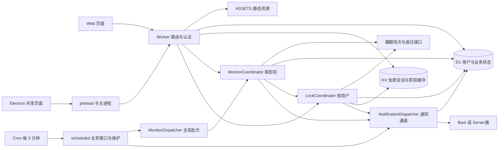

# Movie 架构与代码导航

Movie 是 `tools` 部署的电影监控和锁座业务。`movie.ltools.asia` 是当前入口，
`ltools.asia/maoyan` 保留兼容；源码目录中的 `maoyan` 是历史名称，不是另一个模块。
本文说明当前代码，不把默认策略、测试样本或历史容量估算当作生产事实。

## 架构总览

[交互架构图](diagrams/movie-architecture.html)可以展开组件源码证据；
[图源 JSON](diagrams/movie-architecture.json)随文档维护。
GitHub 直接显示上面的 Mermaid；交互图需下载或本地打开 HTML。
调度、通知重试及座位链路分别见[监控与数据](movie-monitoring.md)、
[座位解析与反馈](movie-seats.md)。

## 仓库与运行时所有权

| 范围 | 归属与入口 |
| --- | --- |
| Web、领取/下载/管理页、共享业务脚本 | `movie` 子仓库的 [pages/maoyan](../modules/movie/pages/maoyan/index.html) |
| Electron 主进程、preload、打包和安装 | `movie` 子仓库的 [desktop](../modules/movie/desktop/README.md) |
| Host/路径分流、认证、所有业务 API | 主仓库 [worker/src/index.js](../worker/src/index.js) |
| D1、KV、四类 DO、Cron、生产 Worker 发布 | 主仓库 [wrangler.toml](../worker/wrangler.toml)、[schema.sql](../worker/schema.sql) |
| 固定子仓库版本与静态资源装配 | [.gitmodules](../.gitmodules)、[build-assets.mjs](../worker/scripts/build-assets.mjs) |

Web 和 Electron 复用页面源码，但安装包包含发布时的页面副本，不会随线上 Web
部署自动更新。子仓库单独提交不会部署 Worker；父仓库固定 gitlink，构建时只复制
允许发布的资源。前端和桌面进程详解见 [Movie 知识库](../modules/movie/knowledge/README.md)。

## 请求与认证

[index.js](../worker/src/index.js) 先处理公开领取与 Store 路由，再处理 Movie 的
`/api/*`；非 API 请求经 Host/旧路径规范化后交给 ASSETS。公开认证/能力接口、
`/api/admin/*` 与普通账号接口有不同入口，不能理解成所有请求都先用 `X-Token`。
普通 Movie 请求由 [auth.js](../worker/src/maoyan/auth.js) 校验凭据，
[business.js](../worker/src/common/business.js) 隔离业务线。
管理操作使用 `X-Admin-Token`，管理员监控会话与业务用户凭据另行处理。

账号过期或停用不等于完全禁止读取：入口明确保留锁座规则/会话状态、取消规则、
移除会话、监控状态/变化读取和停止监控能力；开启监控、手动检查、上传会话及
创建规则等仍受活跃账号检查。撤销清理由
[account-lifecycle.js](../worker/src/maoyan/account-lifecycle.js) 协调，D1
触发器阻止已撤销账号重新产生相关业务状态。

配置通过 [user.js](../worker/src/maoyan/user.js) 和
[monitor-store.js](../worker/src/maoyan/monitor-store.js) 保存，版本用于防止陈旧
配置覆盖。返回前会去除通知密钥等敏感字段。开启监控前必须配置并验证所选推送
渠道，测试推送走直接发送路径；正式事件使用通知 outbox，不能把两者混为一谈。

## 数据分层

| 存储 | 当前职责 |
| --- | --- |
| D1 | 用户、访问凭据、领取/会话版本、配置、监控订阅、影院当前/运行中状态、变化记录、锁座规则、通知 outbox、座位反馈、业务策略与维护检查点 |
| MAOYAN_KV | 版本化加密猫眼会话信封与 `cache:cinemas:*` 影院搜索缓存，不是用户状态主库 |
| DO storage/alarm | 批次游标与待处理批次、限流/串行化、通知通道和重试唤醒；业务持久状态仍以 D1 为准 |
| ASSETS | 从固定 Movie/Store 子仓库装配的静态资源，不含用户凭据或会话 |

[lock-session.js](../worker/src/maoyan/lock-session.js) 用 D1 的会话版本协调 KV
信封的提交与清理；D1 指向的活动版本才是可用会话。删除本地文件、页面隐藏或
配置显示“暂停”，都不能证明云端写入及 DO alarm 已停止。

## 上游与安全边界

[lock-client.js](../worker/src/maoyan/lock-client.js) 限定猫眼 HTTPS 主机：座位页
在 `www.maoyan.com`，创建未支付订单在 `m.maoyan.com/ajax/createOrder`。
请求使用校验后的会话 Cookie、UA 和捕获的下单查询参数；正式路径不在 Worker
动态生成 `mtgsig`。桌面登录捕获与本地取证保留相关校验，不代表正式下单采用同一
签名算法。创建订单不自动支付，响应异常不能当作“肯定没有创建订单”。

会话、令牌与密钥不进入静态资源和仓库。诊断细节经
[failure-detail.js](../worker/src/maoyan/failure-detail.js) 脱敏，座位反馈只保存标识
而非原始 HTML。生产前置、密钥名称核对与回滚要求见
[Cloudflare 运维](cloudflare.md)及 [D1 部署说明](../worker/DEPLOY-D1.md)。

## 阅读与验证

推荐顺序：`index.js` 请求入口 → Movie 前端知识库 → `monitor-dispatcher.js` /
`monitor-coordinator.js` → `monitor-store.js` → `lock-api.js` / `lock-runner.js` →
`notification-outbox.js` → `lock-client.js` / `seat-layout.js`。

本地检查命令见[知识库首页](README.md)。修改 API、数据或重试机制时，还应运行
对应 Worker 测试，覆盖正常、失败与重试；本地测试通过不代替生产现场核验。
本文不声称生产版本查询或外部猫眼接口已恢复，线上结果需独立验证。
